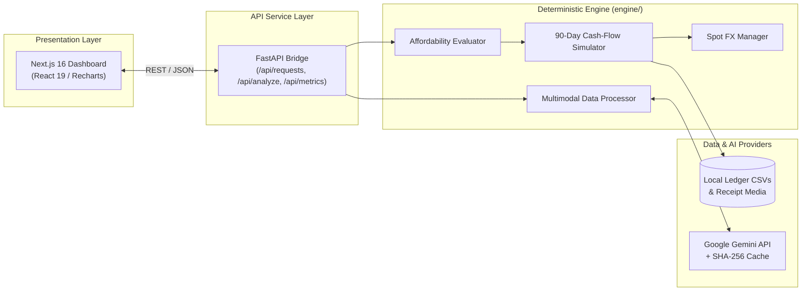

<div align="center">
  <h1>AURELIS</h1>
  <p><b>Deterministic Financial Affordability & Cash-Flow Intelligence Engine</b></p>

  <p>
    <a href="https://github.com/m4n1kya/AURELIS/actions/workflows/python-app.yml"></a>
    <a href="https://github.com/m4n1kya/AURELIS/actions/workflows/nextjs.yml"></a>
    
    
    <a href="https://github.com/m4n1kya/AURELIS/blob/main/LICENSE"></a>
  </p>
</div>

---

**AURELIS** is a privacy-first financial decision engine and interactive command center that evaluates purchase affordability, models 90-day daily cash-flow trajectories, and synthesizes optimal payment plans without ever breaching required liquidity reserves.

Unlike static budgeting trackers, AURELIS combines a **strict deterministic simulation core** with **multimodal AI evidence extraction**—reconciling multi-currency ledger events, recurring obligations, receipt images, and unstructured financial messages into verifiable affordability decisions.

---

## Key Capabilities

- **90-Day Deterministic Liquidity Simulation**: Projects daily net cash flows across a 90-day forward window, automatically inferring weekly and monthly recurring obligations while preventing duplicate ledger entries.
- **Multimodal Evidence Extraction**: Parses unstructured financial notifications and receipt imagery via Google Gemini with SHA-256 content-addressable caching and deterministic offline fallback.
- **Multi-Currency Spot Normalization**: Converts foreign-denominated debits and credits (`EUR`, `IDR`, `JPY`, `CHF`, `PLN`, `USD`) into the user's home currency using settlement-date spot rates.
- **Quantitative Financial Metrics Suite**: Includes 55+ standardized financial health calculators (cash runway, net burn rate, DSCR, DTI, liquidity ratios, Altman Z-Score, DuPont ROE, IRR, MIRR, NPV).
- **Real-Time Financial Command Center**: High-contrast Next.js dashboard for inspecting request decisions, event ledgers, and 90-day cash-flow trajectories.

---

## System Architecture



For mathematical formulations and recurrence deduction rules, see [`docs/ARCHITECTURE.md`](docs/ARCHITECTURE.md).

---

## Repository Structure

```text
AURELIS/
├── api/                  # FastAPI REST service & engine orchestration bridge
│   ├── aurelis_service.py
│   └── main.py
├── dataset/              # Financial profiles, events, FX rates, and receipt media
├── docker/               # Production container definitions for API and Frontend
├── docs/                 # Technical architecture & algorithmic specifications
├── engine/               # Pure-Python deterministic financial simulation core
│   ├── data_processor.py
│   ├── evaluator.py
│   ├── exceptions.py
│   ├── exchange_rates.py
│   ├── finance.py
│   ├── financial_metrics.py
│   ├── llm_client.py
│   └── run_production.py
├── frontend/             # Next.js 16 real-time financial intelligence dashboard
├── tests/                # Automated pytest unit & API integration suite
├── utils/                # Shared currency & formatting utilities
├── Makefile              # Developer workflow automation
├── docker-compose.yml    # Full-stack container orchestration
├── pyproject.toml        # Python package metadata, pytest, and linter config
└── requirements.txt      # Core Python dependencies
```

---

## Getting Started

### Prerequisites

- **Python** `3.10+`
- **Node.js** `20+` & `npm`
- **Google Gemini API Key** *(optional — offline deterministic cache included)*

### 1. Clone & Configure

```bash
git clone https://github.com/m4n1kya/AURELIS.git
cd AURELIS
cp .env.example .env
```

### 2. Start the Backend API

```bash
pip install -r requirements.txt
python -m uvicorn api.main:app --host 0.0.0.0 --port 8000 --reload
```

The API service will be live at `http://localhost:8000` (interactive OpenAPI docs at `http://localhost:8000/docs`).

### 3. Start the Frontend Dashboard

In a separate terminal:

```bash
cd frontend
npm ci
npm run dev
```

Open `http://localhost:3000` in your browser.

---

## CLI Batch Execution & Docker

### Run Standalone Batch Evaluation
The core engine operates independently of any web server and can evaluate the entire dataset in batch mode:

```bash
python engine/run_production.py
```

### Run with Docker Compose

```bash
docker compose up --build
```

---

## Testing & Quality Assurance

Run the automated Python test suite and frontend linter:

```bash
# Run unit and API integration tests
pytest tests/ -v

# Run Next.js ESLint checks
cd frontend && npm run lint
```

---

## API Reference

| Method | Endpoint | Description |
| :--- | :--- | :--- |
| `GET` | `/api/health` | Health check and engine status verification |
| `GET` | `/api/requests` | Retrieve all financial requests and baseline metadata |
| `GET` | `/api/analyze/{request_id}` | Execute deterministic 90-day evaluation for a specific request |
| `GET` | `/api/metrics/{request_id}` | Compute quantitative financial health, liquidity, and runway indicators |

---

## License

Distributed under the MIT License. See [`LICENSE`](LICENSE) for full details.